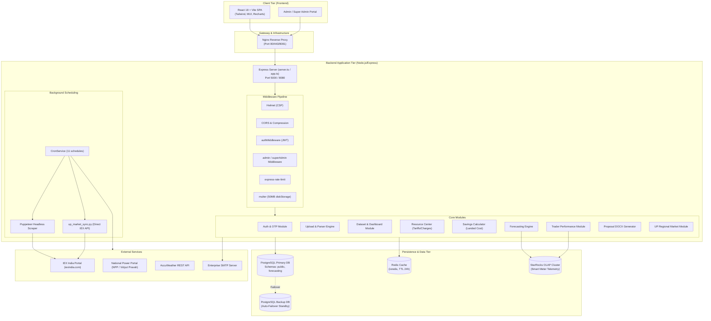
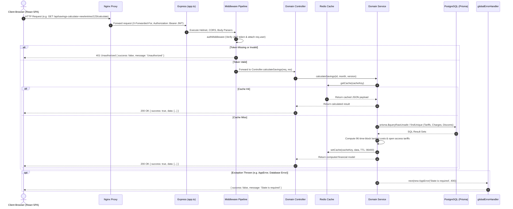
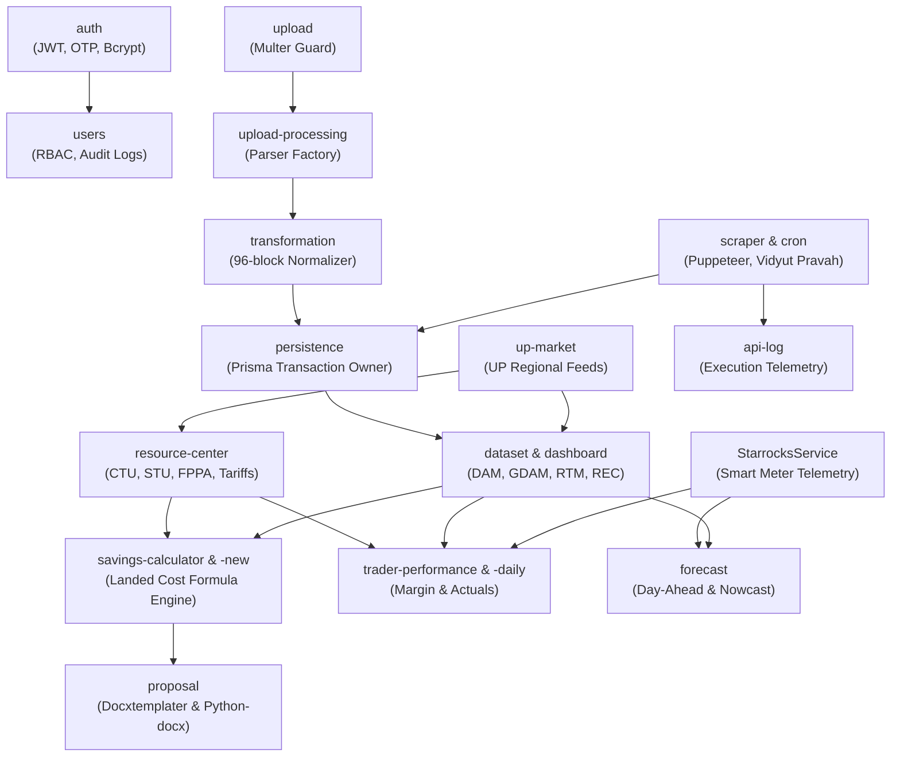

# Prolt Energy - IEX Analytics & Power Portfolio Management Platform
# Document 01: Architecture Overview & System Topology

## 1. Executive Summary & Purpose
The **Prolt Energy / IEX Analytics Dashboard** is an enterprise energy portfolio intelligence and power trading decision-support platform designed for the Indian Power Market. Its primary capabilities include:
1. **Exchange Market Analytics:** Real-time ingestion, parsing, and historical analytics for India Energy Exchange (IEX) products:
   - **DAM:** Day-Ahead Market (96 15-minute time blocks per operational day).
   - **GDAM:** Green Day-Ahead Market (Solar, Non-Solar, Hydro, Wind, Other RE, DRE).
   - **RTM:** Real-Time Market (half-hourly sessions, 48-96 trading slots).
   - **REC:** Renewable Energy Certificates (Solar and Non-Solar monthly auction clearances).
2. **Open Access Landed Cost Savings Engines:** High-precision financial calculators that benchmark state grid tariffs (e.g. Uttar Pradesh HV-1, HV-2, LMV categories) against open access procurement across CTU, STU, wheeling charges, cross-subsidy surcharge (CSS), additional surcharge (AS), banking, and electricity duty.
3. **Forecasting & ML Pipelines:** Day-ahead, nowcast, and all-India demand/generation forecasting across 96 time blocks utilizing historical load profiles, AccuWeather forecasts, Vidyut Pravah telemetry, and StarRocks smart-meter time-series.
4. **Trader Performance Benchmarking:** Actual vs. planned procurement margin, volume, and cost tracking with automated PDF parsing of trader execution reports.
5. **Contract & Proposal Automation:** Generation of technical and commercial proposal contracts in Microsoft Word (`.docx`) and high-volume financial sheets in Microsoft Excel (`.xlsx`).

---

## 2. Technology Stack & Versions

| Layer | Technology | Version | Purpose in Codebase | Reference File |
|---|---|---|---|---|
| **Runtime Environment** | Node.js | v20.x / v26.x | JavaScript runtime with CommonJS module system | [`backend/package.json`](file:///Users/yashgupta/IEX-Dashboard/backend/package.json) |
| **Language** | TypeScript | `^6.0.3` (transpiled via `ts-node` / `tsc`) | Strong typing across controllers, DTOs, and services | [`backend/tsconfig.json`](file:///Users/yashgupta/IEX-Dashboard/backend/tsconfig.json) |
| **Web Framework** | Express.js | `^4.21.2` | HTTP REST routing, middleware pipeline, JSON handling | [`backend/src/app.ts`](file:///Users/yashgupta/IEX-Dashboard/backend/src/app.ts) |
| **ORM / Data Access** | Prisma Client | `^5.22.0` | Multi-schema PostgreSQL modeling (`public`, `forecasting`) | [`backend/prisma/schema.prisma`](file:///Users/yashgupta/IEX-Dashboard/backend/prisma/schema.prisma) |
| **Primary Database** | PostgreSQL | 16-alpine / 17 | Core transactional and analytical storage | [`backend/docker-compose.yml`](file:///Users/yashgupta/IEX-Dashboard/backend/docker-compose.yml) |
| **Failover Database** | PostgreSQL | 16 / 17 | Automatic secondary standby database connection | [`backend/src/config/prisma.ts`](file:///Users/yashgupta/IEX-Dashboard/backend/src/config/prisma.ts) |
| **Distributed Cache** | Redis / ioredis | `^5.4.1` (Redis 7) | High-speed caching with automatic fallback on failure | [`backend/src/config/redis.ts`](file:///Users/yashgupta/IEX-Dashboard/backend/src/config/redis.ts) |
| **OLAP Engine** | StarRocks (MySQL Protocol) | `mysql2 ^3.23.3` | Direct high-throughput smart-meter interval queries | [`backend/src/services/starrocks.service.ts`](file:///Users/yashgupta/IEX-Dashboard/backend/src/services/starrocks.service.ts) |
| **Task Scheduler** | node-cron | `^4.5.0` | In-process cron scheduler for scrapers and backups | [`backend/src/services/cron.service.ts`](file:///Users/yashgupta/IEX-Dashboard/backend/src/services/cron.service.ts) |
| **Browser Scraper** | Puppeteer | `^25.4.0` | Headless Chromium scraper for official IEX snapshots | [`backend/src/modules/scraper/scraper.service.ts`](file:///Users/yashgupta/IEX-Dashboard/backend/src/modules/scraper/scraper.service.ts) |
| **HTTP Client** | Axios & Axios-Retry | `axios ^1.18.1`, `axios-retry ^4.5.0` | External API requests to IEX, NPP, AccuWeather | [`backend/src/services/scraper.service.ts`](file:///Users/yashgupta/IEX-Dashboard/backend/src/services/scraper.service.ts) |
| **Document Processing**| Docxtemplater, PizZip, ExcelJS | `docxtemplater ^3.69.3`, `exceljs ^4.4.0` | Client Word proposals and Excel export generation | [`backend/src/modules/proposal/proposal.service.ts`](file:///Users/yashgupta/IEX-Dashboard/backend/src/modules/proposal/proposal.service.ts) |
| **Security & Auth** | JWT & BcryptJS | `jsonwebtoken ^9.0.3`, `bcryptjs ^3.0.3` | Stateless Bearer token verification, password hashing | [`backend/src/middleware/auth.middleware.ts`](file:///Users/yashgupta/IEX-Dashboard/backend/src/middleware/auth.middleware.ts) |
| **Security Headers** | Helmet | `^8.2.0` | CSP, X-Frame-Options, HSTS headers | [`backend/src/app.ts:L19-L29`](file:///Users/yashgupta/IEX-Dashboard/backend/src/app.ts#L19-L29) |
| **Rate Limiter** | express-rate-limit | `^8.5.2` | Brute force login protection & upload disk DDoS guards | [`backend/src/modules/auth/auth.routes.ts`](file:///Users/yashgupta/IEX-Dashboard/backend/src/modules/auth/auth.routes.ts) |

---

## 3. Directory Structure Explained

```
/Users/yashgupta/IEX-Dashboard
├── backend/
│   ├── Dockerfile                       # Multi-stage production build (Node 20 + Python + Chromium)
│   ├── docker-compose.yml               # Local/Dev orchestration (Postgres, Redis, Backend)
│   ├── docker-compose.remote.yml        # Production deployment compose profile
│   ├── package.json                     # Backend dependencies and seed scripts
│   ├── tsconfig.json                    # TypeScript compiler options
│   ├── assets/                          # Static Word document templates and corporate logos
│   │   ├── templates/                   # COMMERCIAL PROPOSAL_33KV.docx, Technical Proposal templates
│   │   └── logo.png                     # Prolt Energy header branding
│   ├── prisma/
│   │   ├── schema.prisma                # 58 Prisma models across public and forecasting schemas
│   │   ├── seed.ts                      # Database seeder for admin, client, and state charges
│   │   └── migrations/                  # Historical SQL migration steps
│   ├── scripts/                         # Python scripts and shell utilities
│   │   ├── generate_commercial_proposal.py # Python-docx commercial proposal builder
│   │   ├── generate_technical_proposal.py  # Python-docx technical proposal builder
│   │   ├── up_market_sync.py            # Direct IEX SOAP API syncer for Uttar Pradesh DAM/GDAM/RTM
│   │   ├── db_backup.sh                 # Database dump and 7-day retention script
│   │   └── daily_db_backup.sh           # Production 14-day retention backup script
│   └── src/
│       ├── app.ts                       # Express application configuration and middleware stack
│       ├── server.ts                    # HTTP server bootstrap, Prisma connect, graceful shutdown
│       ├── swagger.ts                   # Swagger-UI mount point at /api-docs
│       ├── config/                      # Infrastructure singletons
│       │   ├── index.ts                 # Validated environment configurations
│       │   ├── prisma.ts                # PrismaClient with transparent failover proxy
│       │   ├── redis.ts                 # ioredis client with reconnect retry limits & silent fallbacks
│       │   └── multer.ts                # Multer diskStorage and file validation filters
│       ├── logger/                      # Console and structured file logging
│       ├── middleware/                  # Express middleware pipeline
│       │   ├── auth.middleware.ts       # JWT Bearer token verification & req.user attachment
│       │   ├── admin.middleware.ts      # Role check (req.user.role === 'ADMIN')
│       │   ├── super-admin.middleware.ts# Role check (req.user.role === 'SUPER_ADMIN')
│       │   ├── upload.middleware.ts     # Multer error wrapper and disk cleanup on failure
│       │   ├── errorHandler.ts          # Centralized AppError vs 500 handler
│       │   └── asyncHandler.ts          # Async route promise wrapper
│       ├── services/                    # Cross-cutting infrastructure services
│       │   ├── cron.service.ts          # Background job manager (NPP, Weather, RTM, DAM, CTU)
│       │   ├── scraper.service.ts       # Vidyut Pravah & National Power Portal scrapers
│       │   ├── iex-scraper.service.ts   # Puppeteer scraper for IEX official snapshots
│       │   ├── weather.service.ts       # WeatherEngine for AccuWeather hourly & daily forecasts
│       │   ├── starrocks.service.ts     # OLAP connection pool for consumer smart meters
│       │   ├── email-alert.service.ts   # SMTP transporter for missing resource charges alerts
│       │   └── audit-log.service.ts     # Audit log persistence helper
│       ├── utils/                       # Shared utility functions (AppError, JWT, Decimal, Password)
│       └── modules/                     # 20 Domain-driven modular components
│           ├── auth/                    # Login, OTP generation, verification, and /me
│           ├── upload/                  # Multipart file upload controllers and validators
│           ├── upload-processing/       # Factory dispatch to DAM/GDAM/RTM/REC parsers
│           ├── transformation/          # Header mapping and normalization to 96 interval records
│           ├── persistence/             # Atomic Prisma $transaction dataset persistence
│           ├── dataset/                 # Dataset querying, history, and public dashboard feeds
│           ├── resource-center/         # Master regulatory charges, CTU, STU, FPPA, tariffs
│           ├── savings-calculator/      # Original landed cost & open access savings engine
│           ├── savings-calculator-new/  # Advanced client landed cost engine with versioning
│           ├── trader-performance/      # Planned vs actual trading cost & trade report parsing
│           ├── trader-performance-daily/# Daily meter analysis & smart-meter reconciliation
│           ├── forecast/                # Day-ahead price, generation, and demand forecasting
│           ├── proposal/                # Technical and commercial Word proposal generators
│           ├── up-market/               # Regional UP market analysis data endpoints
│           ├── landing-price-calc/      # IEX calculator API proxy and TOD slot breakdown
│           ├── scraper/                 # Manual scraper trigger & webhook data import
│           ├── database/                # Historical demand, weather, holidays, and city-state data
│           ├── api-log/                 # API execution telemetry and latency logging
│           ├── market-operations/       # Unified interval views across DAM, GDAM, and RTM
│           └── users/                   # Super-Admin user CRUD, RBAC, and audit logs
├── frontend/                            # React 18 + Vite frontend SPA
└── docs/                                # Project documentation and migration specs
```

---

## 4. Entry Points & Startup / Bootstrap Sequence

### 4.1 Server Startup Sequence ([`backend/src/server.ts`](file:///Users/yashgupta/IEX-Dashboard/backend/src/server.ts))
1. **Uncaught Exception Trap:** Catches any unhandled synchronous exception at line 8 and exits process safely with code 1.
2. **HTTP Listener Bind:** Starts Express server on `config.port` (default `5000` / container `8080`).
3. **Database Connection & Failover:**
   - Calls `await prisma.$connect()`.
   - The connection passes through the Proxy defined in [`backend/src/config/prisma.ts`](file:///Users/yashgupta/IEX-Dashboard/backend/src/config/prisma.ts).
   - If `DATABASE_URL` is unreachable, it logs a warning and attempts failover to `BACKUP_DATABASE_URL`.
4. **Unhandled Rejection Trap:** Listens for unhandled asynchronous rejections at line 28, logs the error, and gracefully shuts down the HTTP server.
5. **Signal Trapping & Graceful Teardown:**
   - Listens for `SIGTERM` and `SIGINT`.
   - Stops incoming HTTP connections via `server.close()`.
   - Closes Redis connections via `disconnectRedis()`.
   - Disconnects Prisma via `prisma.$disconnect()`.
   - Enforces a hard timeout of 10,000ms if connections fail to close promptly.

### 4.2 Application Initialization Pipeline ([`backend/src/app.ts`](file:///Users/yashgupta/IEX-Dashboard/backend/src/app.ts))
1. **Proxy Trust:** `app.set('trust proxy', 1)` enables accurate client IP resolution behind Nginx reverse proxies for rate limiters.
2. **Security Headers (Helmet):** Configures Content Security Policy (CSP) permitting inline styles, eval (for charting), and Swagger validator images.
3. **Compression:** `compression()` enables gzip/deflate response compression.
4. **CORS:** Dynamic origin reflector matching `config.corsOrigin` with `credentials: true`.
5. **Body Parsers:** `express.json({ limit: '50mb' })` and `express.urlencoded({ extended: true, limit: '50mb' })` accommodate large Excel/JSON payloads.
6. **Background Scheduling:** Calls [`CronService.init()`](file:///Users/yashgupta/IEX-Dashboard/backend/src/services/cron.service.ts#L17). If `RUN_SCRAPER === true`, schedules 11 cron tasks in the `Asia/Kolkata` timezone.
7. **Swagger Documentation:** Mounts Swagger UI at `/api-docs` via [`setupSwagger(app)`](file:///Users/yashgupta/IEX-Dashboard/backend/src/swagger.ts).
8. **Routing Registration:** Mounts 19 route modules onto `/api/*` and exposes `/health` and `/health/database`.
9. **404 Catch-All:** Instantiates `AppError("Can't find ${req.originalUrl} on this server!", 404)` for undefined endpoints.
10. **Global Error Handler:** Catches all rejected promises, logs operational vs programmer errors, and formats JSON responses.

---

## 5. Layered Architecture

The application strictly adheres to a five-layer architectural model:

```
[ Client: React SPA / Webhook / External API ]
                      │
                      ▼
┌─────────────────────────────────────────────────────────┐
│ 1. Routing & Middleware Layer                           │
│    - Express Routers (*.routes.ts)                      │
│    - Rate Limiters (loginLimiter, uploadLimiter)        │
│    - Security & Auth (authMiddleware, superAdmin)       │
│    - Upload Guards (handleUpload, uploadCleanupOnError) │
└─────────────────────────┬───────────────────────────────┘
                          │
                          ▼
┌─────────────────────────────────────────────────────────┐
│ 2. Controller Layer                                     │
│    - Express Request/Response Handlers (*.controller.ts)│
│    - Request DTO extraction & Query parsing             │
│    - HTTP Status mapping & Error delegation             │
└─────────────────────────┬───────────────────────────────┘
                          │
                          ▼
┌─────────────────────────────────────────────────────────┐
│ 3. Service Layer                                        │
│    - Domain Business Logic (*.service.ts)               │
│    - Tariff & Landed Cost Computations                  │
│    - Forecast aggregation & Demand shifting             │
│    - Cache check & cache invalidation (Redis)           │
└─────────────────────────┬───────────────────────────────┘
                          │
                          ▼
┌─────────────────────────────────────────────────────────┐
│ 4. Persistence & Transaction Layer                      │
│    - Atomic Unit of Work (PersistenceService)           │
│    - Prisma Client Transactions (prisma.$transaction)   │
│    - Direct SQL Queries (prisma.$queryRawUnsafe)        │
│    - StarRocks Pool (mysql2/promise)                    │
└─────────────────────────┬───────────────────────────────┘
                          │
                          ▼
┌─────────────────────────────────────────────────────────┐
│ 5. Physical Storage & External Services                 │
│    - PostgreSQL (public & forecasting schemas)          │
│    - Redis Cache Store                                  │
│    - StarRocks OLAP Database                            │
│    - External APIs (IEX, NPP, AccuWeather, SMTP)        │
└─────────────────────────────────────────────────────────┘
```

---

## 6. Architecture & Lifecycle Diagrams

### 6.1 Component Architecture Diagram


---

### 6.2 Request Lifecycle Diagram


---

## 7. Module Dependency Graph


