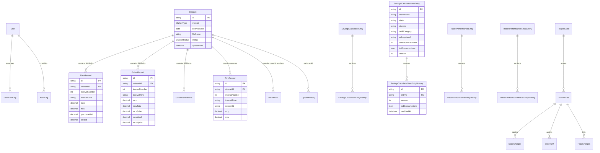

# Prolt Energy - IEX Analytics & Power Portfolio Management Platform
# Document 03: Data Model, Database Schema & JPA/Hibernate Mapping

## 1. Executive Summary & Architecture
The persistence architecture of the Prolt Energy / IEX platform is powered by PostgreSQL 16+ utilizing a **multi-schema design**:
1. **`public` schema:** Houses application users, role-based access control, master regulatory charges (CTU, STU, wheeling, banking, cross-subsidy), IEX market clearance datasets (DAM, GDAM, RTM, REC), scraped exchange rates, holiday calendars, open access savings calculators, and trader performance benchmarks.
2. **`forecasting` schema:** Houses high-volume 96-time-block machine learning model outputs, day-ahead price forecasts, all-India demand forecasts, consumer load predictions, and generation forecasts.

The database catalog contains **58 models / tables** managed via Prisma ORM in [`backend/prisma/schema.prisma`](file:///Users/yashgupta/IEX-Dashboard/backend/prisma/schema.prisma).

---

## 2. Entity-Relationship Diagram (Mermaid)



---

## 3. Complete Entity Catalog (All 58 Models)

### 3.1 User Management & Security (`public` schema)

#### 1. `User` (Table: `User`, Schema: `public`)
- **File:** [`backend/prisma/schema.prisma:L12-L26`](file:///Users/yashgupta/IEX-Dashboard/backend/prisma/schema.prisma#L12-L26)
- **Columns:**
  - `id`: `String` (UUID PK, default: `uuid()`)
  - `username`: `String` (VARCHAR 50, UNIQUE, NOT NULL, indexed)
  - `email`: `String` (VARCHAR 255, UNIQUE, NOT NULL, indexed)
  - `passwordHash`: `String` (VARCHAR 255, NOT NULL)
  - `role`: `Role` enum (`SUPER_ADMIN`, `ADMIN`, `CLIENT`, default: `CLIENT`)
  - `hiddenModules`: `String[]` (VARCHAR[], default: `[]`)
  - `readOnlyModules`: `String[]` (VARCHAR[], default: `[]`)
  - `createdAt`: `DateTime` (default: `now()`)
  - `updatedAt`: `DateTime` (updatedAt)
- **JPA Translation:**
  ```java
  @Entity
  @Table(name = "User", schema = "public")
  public class User {
      @Id
      @GeneratedValue(strategy = GenerationType.UUID)
      private UUID id;
      @Column(length = 50, unique = true, nullable = false)
      private String username;
      @Column(length = 255, unique = true, nullable = false)
      private String email;
      @Column(name = "passwordHash", length = 255, nullable = false)
      private String passwordHash;
      @Enumerated(EnumType.STRING)
      @Column(nullable = false)
      private Role role = Role.CLIENT;
      @Column(name = "hiddenModules", columnDefinition = "text[]")
      @JdbcTypeCode(SqlTypes.ARRAY)
      private List<String> hiddenModules = new ArrayList<>();
      @Column(name = "readOnlyModules", columnDefinition = "text[]")
      @JdbcTypeCode(SqlTypes.ARRAY)
      private List<String> readOnlyModules = new ArrayList<>();
  }
  ```

#### 2. `UserAuditLog` (Table: `UserAuditLog`, Schema: `public`)
- **Columns:** `id` (UUID PK), `action` (VARCHAR 50), `targetUserId` (UUID), `targetUser` (VARCHAR 100), `performedBy` (VARCHAR 100), `changes` (JSONB, NOT NULL), `timestamp` (DateTime default: `now()`).

#### 3. `AuditLog` (Table: `AuditLog`, Schema: `public`)
- **Columns:** `id` (UUID PK), `tableName` (VARCHAR 100), `recordId` (VARCHAR 100), `action` (VARCHAR 50), `oldData` (JSONB NULL), `newData` (JSONB NULL), `userId` (VARCHAR 100 NULL), `createdAt` (DateTime default: `now()`).

#### 4. `user_details` (Table: `user_details`, Schema: `public`)
- **Columns:** Legacy user metadata table with contact numbers and designations.

---

### 3.2 Exchange Clearance Datasets & Interval Records (`public` schema)

#### 5. `Dataset` (Table: `Dataset`, Schema: `public`)
- **File:** [`backend/prisma/schema.prisma:L28-L49`](file:///Users/yashgupta/IEX-Dashboard/backend/prisma/schema.prisma#L28-L49)
- **Columns:**
  - `id`: `String` (UUID PK)
  - `market`: `MarketType` (`DAM`, `GDAM`, `RTM`, `REC`)
  - `deliveryDate`: `DateTime` (`@db.Date`, NOT NULL)
  - `fileName`: `String` (VARCHAR 255)
  - `status`: `DatasetStatus` (`ACTIVE`, `REPLACED`, `DELETED`, default: `ACTIVE`)
  - `uploadedAt`: `DateTime` (default: `now()`)
  - `createdAt`, `updatedAt`
- **Indexes:** `[market]`, `[deliveryDate]`, `[status]`, composite `[market, deliveryDate]`.
- **Relations:** 1-to-Many with `DamRecord`, `GdamRecord`, `GdamNewRecord`, `RtmRecord`, `RecRecord`, `UploadHistory` (all `onDelete: Cascade`).

#### 6. `UploadHistory` (Table: `UploadHistory`, Schema: `public`)
- **Columns:** `id` (UUID PK), `datasetId` (UUID FK), `market` (`MarketType`), `deliveryDate` (DATE), `action` (`UploadAction`: `UPLOAD`, `REPLACE`, `DELETE`), `timestamp` (default: `now()`).

#### 7. `DamRecord` (Table: `DamRecord`, Schema: `public`)
- **Columns:** `id` (UUID PK), `datasetId` (UUID FK), `intervalNumber` (SMALLINT, 1-96), `intervalTime` (VARCHAR 15, e.g. "00:00-00:15"), `purchaseBid` (DECIMAL 18,4), `sellBid` (DECIMAL 18,4), `mcv` (DECIMAL 18,4), `fsv` (DECIMAL 18,4), `mcp` (DECIMAL 18,4), `date` (VARCHAR 10).
- **Unique Constraint:** `[datasetId, intervalNumber]`.

#### 8. `GdamRecord` (Table: `GdamRecord`, Schema: `public`)
- **Columns:** `id` (UUID PK), `datasetId` (UUID FK), `intervalNumber` (1-96), `intervalTime`, `purchaseBid`, `sellBidTotal`, `sellBidSolar`, `sellBidNonSolar`, `sellBidHydro`, `sellBidWind`, `sellBidOtherRE`, `mcvTotal`, `mcvSolar`, `mcvNonSolar`, `mcvHydro`, `mcvWind`, `mcvOtherRE`, `fsvTotal`, `fsvHydro`, `fsvWind`, `fsvOtherRE`, `mcp`, `date`.
- **Unique Constraint:** `[datasetId, intervalNumber]`.

#### 9. `GdamNewRecord` (Table: `GdamNewRecord`, Schema: `public`)
- **Columns:** Modern schema format with Distributed Renewable Energy (DRE) columns: `sellBidDRE`, `mcvDRE`, `fsvDRE`.
- **Unique Constraint:** `[datasetId, intervalNumber]`.

#### 10. `RtmRecord` (Table: `RtmRecord`, Schema: `public`)
- **Columns:** `id` (UUID PK), `datasetId` (UUID FK), `intervalNumber` (1-96), `intervalTime`, `sessionId` (VARCHAR 50), `purchaseBid`, `sellBid`, `mcv`, `fsv`, `mcp`, `date`.
- **Unique Constraint:** `[datasetId, intervalNumber]`.

#### 11. `RecRecord` (Table: `RecRecord`, Schema: `public`)
- **Columns:** `id` (UUID PK), `datasetId` (UUID FK), `buyBids` (DECIMAL 18,4), `sellBids`, `clearedPrice`, `clearedVolume`, `month` (VARCHAR 50), `year` (SMALLINT), `noOfParticipants` (INT), `type` (Solar/Non-Solar).
- **Unique Constraint:** `[datasetId, year, month, type]`.

#### 12. `StateMarketRecord` (Table: `StateMarketRecord`, Schema: `public`)
- **Columns:** `id` (UUID PK), `market` (VARCHAR 20), `area` (VARCHAR 100, e.g. "N1", "N2", "UP"), `deliveryDate` (DATE), `intervalNumber` (INT), `intervalTime`, `purchaseBid`, `sellBid`, `clearedVolume`, `price`, `createdAt`, `updatedAt`.
- **Unique Constraint:** `[market, area, deliveryDate, intervalNumber]`.

---

### 3.3 Exchange Rates Populated by Scrapers (`public` schema)

#### 13. `ExchangeDamRate` (Table: `exchange_dam_rate`, Schema: `public`)
- **Columns:** `id` (SERIAL PK), `date` (DATE), `intervalTime` (TIME), `mcp` (DECIMAL 10,2), `mcv` (DECIMAL 15,2), `purchaseBid` (DECIMAL 15,2), `sellBid` (DECIMAL 15,2), `state` (VARCHAR 50), `updated_at` (TIMESTAMPTZ).
- **Unique Constraint:** `[date, intervalTime, state]`.

#### 14. `ExchangeGdamRate` (Table: `exchange_gdam_rate`, Schema: `public`)
- **Columns:** Same structure as `ExchangeDamRate`.
- **Unique Constraint:** `[date, intervalTime, state]`.

#### 15. `ExchangeRtmRate` (Table: `exchange_rtm_rate`, Schema: `public`)
- **Columns:** Same structure as `ExchangeDamRate`.
- **Unique Constraint:** `[date, intervalTime, state]`.

---

### 3.4 Regulatory Master Data & Tariffs (`public` schema)

#### 16. `RegionState` (Table: `region_state`, Schema: `public`)
- **Columns:** `id` (SERIAL PK), `regionalGrid` (VARCHAR 30), `stateName` (VARCHAR 100), `stateCode` (VARCHAR 10), `isStateUt` (`state_ut_enum`), `createdAt`, `updatedAt`.

#### 17. `DiscomList` (Table: `discom_list`, Schema: `public`)
- **Columns:** `id` (SERIAL PK), `regionalGrid`, `stateName`, `discomName` (VARCHAR 100), `category` (VARCHAR 50), `subCategory` (VARCHAR 50), `supplyVoltage` (VARCHAR 50), `effectiveFrom` (DATE), `effectiveTo` (DATE), `tariffRate` (DECIMAL 10,4).

#### 18. `StateCharges` (Table: `state_charges`, Schema: `public`)
- **Columns:** `id` (SERIAL PK), `state`, `discom`, `category`, `subCategory`, `supplyVoltageCategory`, `voltageLevel`, `fromDate` (DATE), `toDate` (DATE), `demandFixedChargeKvaPerMonthRs`, `crossSubsidy`, `distributionWheelingCharges`, `stuCharges`, `stuLossPercent`, `wheelingLossPercent`, `additionalCharge`.

#### 19. `StateTariff` (Table: `state_tariff`, Schema: `public`)
- **Columns:** Discom energy charges, demand charges, TOD peak/off-peak surcharges, and rebates.

#### 20. `IstsCharges` (Table: `ists_charges`, Schema: `public`)
- **Columns:** Central transmission utility (CTU) national and regional transmission loss and wheeling rates.

#### 21. `CtuCharges` (Table: `ctu_charges`, Schema: `public`)
- **Columns:** Monthly ISTS transmission charges (Rs/MW/day or Rs/kWh) and loss percentages.

#### 22. `FppaCharges` (Table: `fppa_charges`, Schema: `public`)
- **Columns:** Fuel and Power Purchase Adjustment (FPPA) monthly surcharges per discom.

#### 23. `IexFees` (Table: `iex_fees`, Schema: `public`)
- **Columns:** Exchange transaction fees (e.g. 0.02 Rs/kWh) and operating charges.

#### 24. `ProltMargin` (Table: `prolt_margin`, Schema: `public`)
- **Columns:** Prolt Energy portfolio advisory and trading consultancy margin parameters.

#### 25. `DsmCharges` (Table: `dsm_charges`, Schema: `public`)
- **Columns:** Deviation Settlement Mechanism (DSM) frequency-linked penalty bands.

---

### 3.5 Savings Calculators (`public` schema)

#### 26. `SavingsCalculatorEntry` (Table: `savings_calculator_entries`, Schema: `public`)
- **Columns:** `id` (UUID PK), `clientName` (VARCHAR 255), `state` (VARCHAR 100), `discom` (VARCHAR 100), `tariffCategory` (VARCHAR 100), `voltageLevel` (VARCHAR 50), `contractDemandKva` (DECIMAL 15,2), `meteringCharges` (DECIMAL 10,2), `todConsumptions` (JSONB), `version` (INT default 1), `createdAt`, `updatedAt`.
- **Relations:** 1-to-Many with `SavingsCalculatorEntryHistory`.

#### 27. `SavingsCalculatorEntryHistory` (Table: `savings_calculator_entry_histories`, Schema: `public`)
- **Columns:** Historical snapshot tracking revisions of `SavingsCalculatorEntry`.

#### 28. `SavingsCalculatorNewEntry` (Table: `savings_calculator_new_entries`, Schema: `public`)
- **Columns:** Enterprise calculator model supporting granular banking charges, electricity duty exemptions, and multi-year TOD profiles.
- **Relations:** 1-to-Many with `SavingsCalculatorNewEntryHistory`.

#### 29. `SavingsCalculatorNewEntryHistory` (Table: `savings_calculator_new_entry_histories`, Schema: `public`)
- **Columns:** Historical version storage for `SavingsCalculatorNewEntry`.

---

### 3.6 Trader Performance Benchmarking (`public` schema)

#### 30. `TraderPerformanceEntry` (Table: `trader_performance_entries`, Schema: `public`)
- **Columns:** Baseline planned procurement configuration for traders.
- **Relations:** 1-to-Many with `TraderPerformanceEntryHistory`.

#### 31. `TraderPerformanceEntryHistory` (Table: `trader_performance_entry_histories`, Schema: `public`)
- **Columns:** Revisions of planned trader baselines.

#### 32. `TraderPerformanceActualEntry` (Table: `trader_performance_actual_entries`, Schema: `public`)
- **Columns:** Actual trading clearing volumes and landed purchase prices parsed from trade execution reports.
- **Relations:** 1-to-Many with `TraderPerformanceActualEntryHistory`.

#### 33. `TraderPerformanceActualEntryHistory` (Table: `trader_performance_actual_entry_histories`, Schema: `public`)
- **Columns:** Revisions of actual trader execution records.

---

### 3.7 Grid Telemetry, Weather & Holidays (`public` schema)

#### 34. `NppRawDemandData` (Table: `NppRawDemandData`, Schema: `public`)
- **Columns:** `id` (SERIAL PK), `date` (VARCHAR 20), `timeStr` (VARCHAR 20), `demandMet` (DECIMAL 15,2), `dataUpdatedAt` (VARCHAR 50), `fetchedAt` (TIMESTAMPTZ).
- **Unique Constraint:** `[date, timeStr]`.

#### 35. `NppRawGenerationData` (Table: `NppRawGenerationData`, Schema: `public`)
- **Columns:** `id` (SERIAL PK), `date`, `timeStr`, `thermal`, `gas`, `nuclear`, `hydro`, `wind`, `solar`, `dataUpdatedAt`, `fetchedAt`.
- **Unique Constraint:** `[date, timeStr]`.

#### 36. `NppAdjustedDemandData` (Table: `NppAdjustedDemandData`, Schema: `public`)
- **Columns:** Normalized 96-time-block interpolated demand met data.

#### 37. `NppAdjustedGenerationData` (Table: `NppAdjustedGenerationData`, Schema: `public`)
- **Columns:** Normalized 96-time-block interpolated fuel generation data.

#### 38. `StateDemandData` (Table: `StateDemandData`, Schema: `public`)
- **Columns:** State-specific real-time load met records from Vidyut Pravah.

#### 39. `WeatherForecast` (Table: `WeatherForecast`, Schema: `public`)
- **Columns:** Daily AccuWeather forecast summaries.

#### 40. `WeatherForecastHourly` (Table: `WeatherForecastHourly`, Schema: `public`)
- **Columns:** Hourly AccuWeather forecast data (temperature, rain, cloud cover).

#### 41. `WeatherHistorical` (Table: `WeatherHistorical`, Schema: `public`)
- **Columns:** Daily historical weather actuals.

#### 42. `HistoricalWeather` (Table: `historical_weather`, Schema: `public`)
- **Columns:** Archived weather telemetry.

#### 43. `HolidayCalendar` (Table: `HolidayCalendar`, Schema: `public`)
- **Columns:** `id` (SERIAL PK), `holidayDate` (DATE), `name` (VARCHAR 100), `state` (VARCHAR 50), `isOperationalHoliday` (BOOLEAN default true).

#### 44. `CityStateData` (Table: `CityStateData`, Schema: `public`)
- **Columns:** `id` (SERIAL PK), `cityName`, `stateName`, `latitude`, `longitude`.

#### 45. `ApiLog` (Table: `ApiLog`, Schema: `public`)
- **Columns:** `id` (SERIAL PK), `apiName`, `endpoint`, `status` (`SUCCESS` | `ERROR`), `message` (TEXT), `timestamp`.

#### 46. `MarketOperation` (Table: `market_operation`, Schema: `public`)
- **Columns:** Operational logs for market clearing jobs.

#### 47. `public_GdamMcpForecast` (Table: `GdamMcpForecast`, Schema: `public`)
- **Columns:** Public view of GDAM clearing price predictions.

---

### 3.8 Machine Learning & Forecasting Models (`forecasting` schema)

#### 48. `DamForecasting` (Table: `dam_forecasting`, Schema: `forecasting`)
- **Columns:** `id` (SERIAL PK), `forecasting_for` (TIMESTAMP), `time_block` (INT, 1-96), `mcp_forecast` (DECIMAL 10,2), `model_number` (INT), `forecast_date` (TIMESTAMP).
- **Unique Logic:** Queried using PostgreSQL `DISTINCT ON (forecasting_for::date, time_block)`.

#### 49. `ForecastGdam` (Table: `gdam_forecasting`, Schema: `forecasting`)
- **Columns:** Green Day-Ahead Market 96-block price and volume predictions.

#### 50. `gdam_dayahead_forecast` (Table: `gdam_dayahead_forecast`, Schema: `forecasting`)
- **Columns:** Day-ahead GDAM price predictions.

#### 51. `forecasting_GdamMcpForecast` (Table: `GdamMcpForecast`, Schema: `forecasting`)
- **Columns:** GDAM MCP ML predictions.

#### 52. `RtmDayahead` (Table: `rtm_dayahead`, Schema: `forecasting`)
- **Columns:** Day-ahead forecast for Real-Time Market prices.

#### 53. `RtmNowcast` (Table: `rtm_nowcast`, Schema: `forecasting`)
- **Columns:** Nowcast (intraday 1-2 hours ahead) price predictions for RTM sessions.

#### 54. `ForecastConsumerDemand` (Table: `consumer_demand_forecasting`, Schema: `forecasting`)
- **Columns:** `id` (SERIAL PK), `meter_id` (VARCHAR 100), `timestamp` (TIMESTAMP), `slot_number` (INT, 1-96), `forecasted_energy` (DECIMAL 15,4), `actual_energy` (DECIMAL 15,4), `forecast_demand` (DECIMAL 15,4).

#### 55. `ForecastAllIndiaDemand` (Table: `all_india_demand_forecasting`, Schema: `forecasting`)
- **Columns:** National demand forecasting profiles.

#### 56. `ForecastAllIndiaDemandV2` (Table: `all_india_demand_forecasting_v2`, Schema: `forecasting`)
- **Columns:** V2 national demand prediction models incorporating weather regressors.

#### 57. `GenerationForecasting` (Table: `Generation_forecasting`, Schema: `forecasting`)
- **Columns:** `id` (SERIAL PK), `forecast_for_timestamp` (TIMESTAMP), `source` (VARCHAR 50, e.g. "SOLAR", "WIND"), `forecast_mw` (DECIMAL 15,2), `actual_mw` (DECIMAL 15,2).

#### 58. `MarketForecasting` (Table: `market_forecasting`, Schema: `forecasting`)
- **Columns:** `id` (SERIAL PK), `forecast_date` (DATE), `market` (VARCHAR 20), `slots` (JSONB).

---

## 4. Raw SQL Queries & Query-Builder Invocations

All raw queries in the Node.js application are executed via `prisma.$queryRawUnsafe`. In the Java target architecture, these must be mapped to native Spring Data queries (`@Query(nativeQuery = true)`) or `JdbcTemplate`:

| File & Line | Query Pattern / SQL Operation | Purpose | Required JPA / Spring Boot Migration Strategy |
|---|---|---|---|
| [`backend/src/app.ts:L114`](file:///Users/yashgupta/IEX-Dashboard/backend/src/app.ts#L114) | `SELECT 1` | Database connection liveness check (`/health/database`). | Handled automatically by Spring Boot Actuator `/actuator/health` via `DataSourceHealthIndicator`. |
| [`backend/src/modules/forecast/forecast.service.ts:L264`](file:///Users/yashgupta/IEX-Dashboard/backend/src/modules/forecast/forecast.service.ts#L264) | `SELECT DISTINCT ON (forecasting_for::date, time_block) * FROM "forecasting"."dam_forecasting" WHERE forecasting_for::date >= $1::date AND forecasting_for::date <= $2::date AND model_number = $3 ORDER BY forecasting_for::date ASC, time_block ASC, forecast_date DESC;` | Deduplicates latest DAM price predictions for given date range. | Spring Data JPA `@Query(nativeQuery = true)` or PostgreSQL `ROW_NUMBER() OVER (...)`. |
| [`backend/src/modules/forecast/forecast.service.ts:L357`](file:///Users/yashgupta/IEX-Dashboard/backend/src/modules/forecast/forecast.service.ts#L357) | `SELECT DISTINCT ON (COALESCE(forecasting_for, date), interval_number) COALESCE(forecasting_for, date)::text AS date, interval_number, mcp FROM "forecasting"."GdamMcpForecast" ...` | Fetches latest GDAM MCP predictions by interval. | Native Spring Data query with DTO projection interface. |
| [`backend/src/modules/forecast/forecast.service.ts:L713, L1263`](file:///Users/yashgupta/IEX-Dashboard/backend/src/modules/forecast/forecast.service.ts#L713) | `SELECT DISTINCT ON (forecast_for_timestamp, source) forecast_for_timestamp, source, forecast_mw FROM "forecasting"."Generation_forecasting" ...` | Fetches generation forecasts per fuel source without duplicates. | Native Spring Data query. |
| [`backend/src/modules/forecast/forecast.service.ts:L829`](file:///Users/yashgupta/IEX-Dashboard/backend/src/modules/forecast/forecast.service.ts#L829) | `SELECT timestamp, (timestamp::date)::text as date_str, slot_number, forecasted_energy, actual_energy FROM "forecasting"."consumer_demand_forecasting" WHERE (timestamp::date)::text = ANY($1::text[]) ORDER BY timestamp ASC, slot_number ASC` | Retrieves 96-time-block smart meter forecast vs actual energy. | Native query using PostgreSQL `ANY(:dates)`. |
| [`backend/src/modules/market-operations/market-operations.service.ts:L47-L82`](file:///Users/yashgupta/IEX-Dashboard/backend/src/modules/market-operations/market-operations.service.ts#L47-L82) | `SELECT COALESCE(dam.date, rtm.date, gdam.date) AS date, dam."intervalTime", dam.mcp AS "damMcp", rtm.mcp AS "rtmMcp", gdam.mcp AS "gdamMcp" FROM "DamRecord" dam FULL OUTER JOIN "RtmRecord" rtm ... FULL OUTER JOIN "GdamRecord" gdam ...` | Merges DAM, GDAM, and RTM interval prices into single comparative row. | `JdbcTemplate` with custom `RowMapper<MarketOperationComparisonDTO>`. |
| [`backend/src/modules/savings-calculator/savings-calculator.service.ts:L794, L1426`](file:///Users/yashgupta/IEX-Dashboard/backend/src/modules/savings-calculator/savings-calculator.service.ts#L794) | `SELECT date, interval_time, mcp, mcv FROM exchange_dam_rate WHERE state = $1 AND date >= $2 AND date <= $3 ...` | Ingests 96-block rates for landed cost math. | Spring Data JPA custom repository method with `JdbcTemplate`. |
| [`backend/src/modules/trader-performance-daily/trader-performance-daily.service.ts:L223`](file:///Users/yashgupta/IEX-Dashboard/backend/src/modules/trader-performance-daily/trader-performance-daily.service.ts#L223) | `SELECT (timestamp::date)::text as date_str, slot_number, actual_energy FROM "forecasting"."consumer_demand_forecasting" WHERE (timestamp::date)::text = ANY($1::text[]) AND meter_id = $2` | Pulls meter actuals for daily trade reconciliation. | Native Spring Data repository query. |
| [`backend/src/get_meters.ts:L4`](file:///Users/yashgupta/IEX-Dashboard/backend/src/get_meters.ts#L4) | `SELECT DISTINCT meter_id FROM "forecasting"."consumer_demand_forecasting" WHERE meter_id IS NOT NULL` | Fetches unique consumer meter list. | Standard Spring Data JPA `findDistinctMeterIds()`. |

---

## 5. Migration to JPA/Hibernate & Flyway

### 5.1 Multi-Schema Management in Spring Data JPA
Configure `application.yml` and Hibernate properties to support dual schemas:
```yaml
spring:
  jpa:
    properties:
      hibernate:
        default_schema: public
```
Entities in the forecasting schema specify `@Table(schema = "forecasting")`:
```java
@Entity
@Table(name = "dam_forecasting", schema = "forecasting")
public class DamForecasting { ... }
```

### 5.2 Flyway Multi-Schema Migration Architecture
Flyway will manage version-controlled SQL scripts:
```yaml
spring:
  flyway:
    enabled: true
    schemas: public, forecasting
    default-schema: public
    locations: classpath:db/migration/common, classpath:db/migration/postgresql
```

### 5.3 Flyway Migration Baseline File Structure
```
src/main/resources/db/migration/
├── V1__initial_schemas_and_enums.sql   # CREATE SCHEMA forecasting; CREATE TYPE Role...
├── V2__create_user_and_audit_tables.sql
├── V3__create_dataset_and_interval_records.sql
├── V4__create_regulatory_master_tables.sql
├── V5__create_savings_calculator_tables.sql
├── V6__create_trader_performance_tables.sql
└── V7__create_forecasting_schema_tables.sql
```
