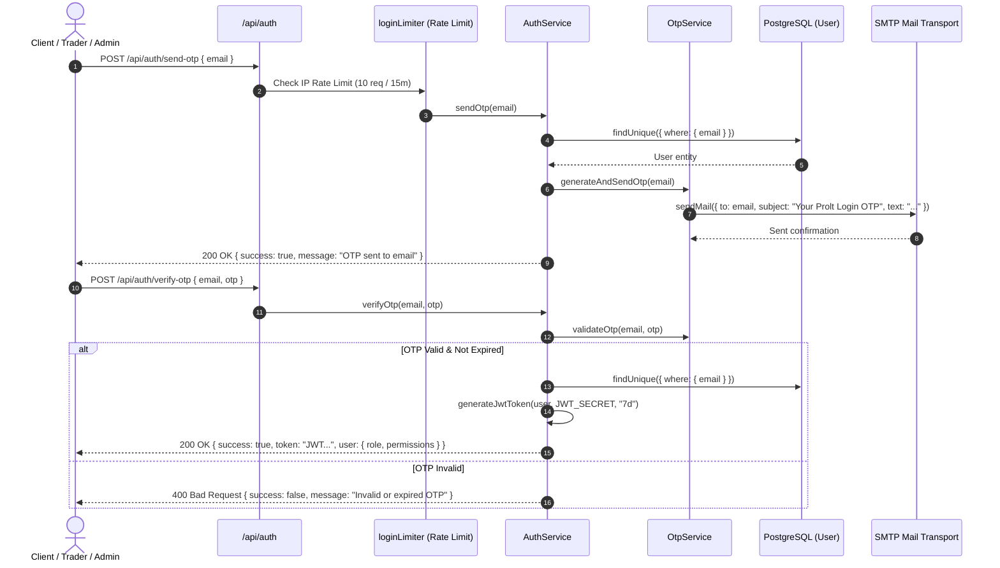
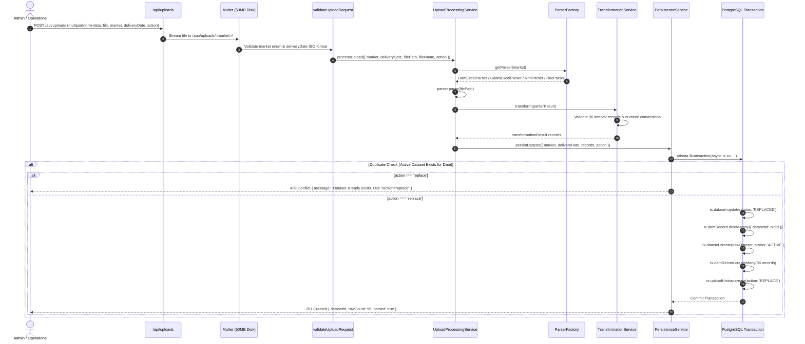
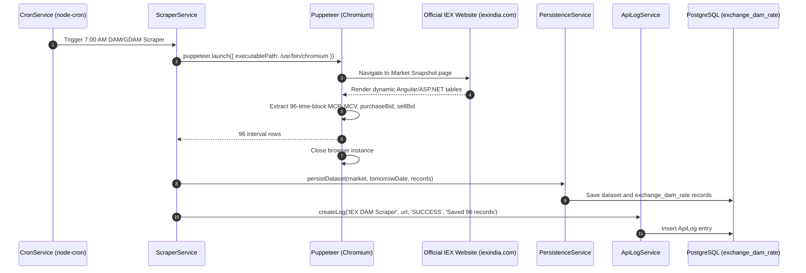
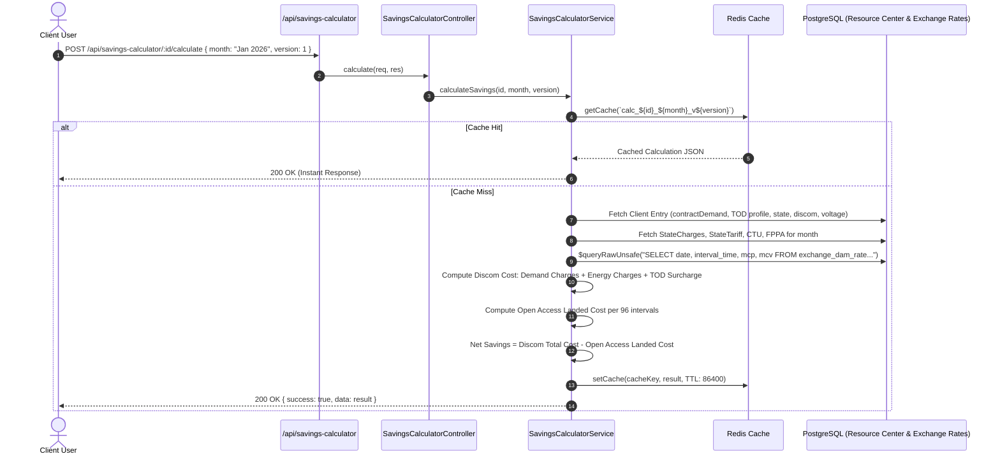
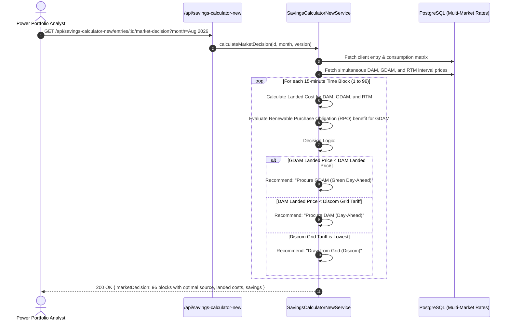
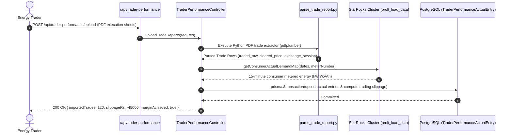
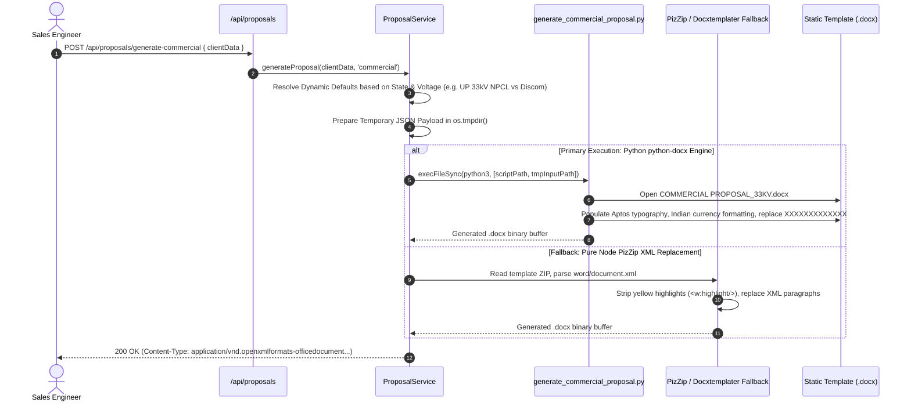
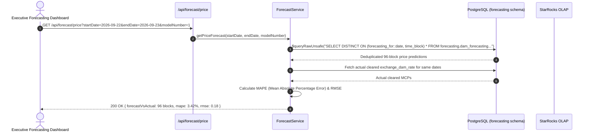
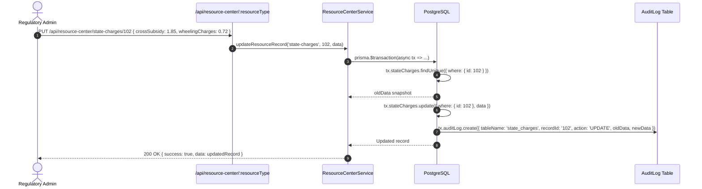
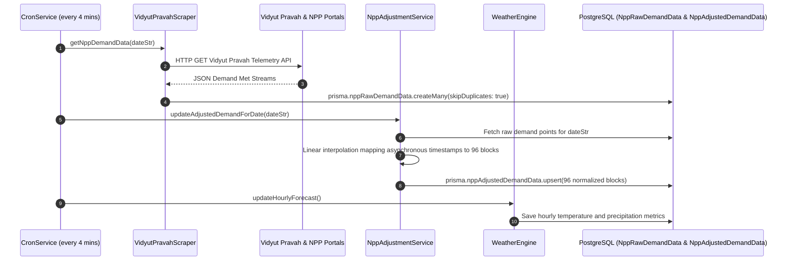

# Prolt Energy - IEX Analytics & Power Portfolio Management Platform
# Document 04: Business Logic, Domain Services & Execution Flows

## 1. Executive Summary & Core Calculations
The business logic of the Prolt Energy platform addresses complex power market clearing, open access tariff calculations, and time-series demand predictions governed by Indian Central Electricity Regulatory Commission (CERC) and State Electricity Regulatory Commission (SERC) regulations.

### 1.1 The Standard 96-Time-Block Indian Grid System
The Indian electrical grid operates on a **15-minute dispatch interval**. A standard operational day is divided into **96 time blocks**:
- Block 1: `00:00 - 00:15`
- Block 2: `00:15 - 00:30`
- ...
- Block 96: `23:45 - 24:00`

All interval records for DAM, GDAM, and RTM align precisely to these 96 blocks.

### 1.2 Open Access Landed Cost Financial Engine
The core financial algorithm determines whether an industrial/commercial consumer saves money procuring power from the exchange (DAM/GDAM/RTM) versus their local distribution licensee (Discom).

$$\text{Landed Cost (Rs/kWh)} = \frac{\text{MCP} + \text{CTU Loss Adjustment}}{1 - \text{STU Loss}} + \text{STU Charges} + \frac{\text{Wheeling Charges}}{1 - \text{Wheeling Loss}} + \text{CSS} + \text{AS} + \text{Banking} + \text{Duty} + \text{IEX Fee} + \text{Margin}$$

Where:
- **$\text{MCP}$:** Market Clearing Price discovered on IEX (Rs/kWh).
- **$\text{CTU Charges & Losses}$:** Central Transmission Utility (national grid) transmission charges and inter-state losses.
- **$\text{STU Charges & Losses}$:** State Transmission Utility intra-state charges and transmission losses.
- **$\text{Wheeling Charges & Losses}$:** Discom distribution network wheeling tariff and technical losses.
- **$\text{CSS (Cross-Subsidy Surcharge)}$:** Statutory surcharge levied by state discoms to subsidize agricultural and domestic consumers.
- **$\text{AS (Additional Surcharge)}$:** Compensatory charge for discom stranded power purchase capacity.
- **$\text{Duty}$:** State electricity duty percentage or fixed per-unit levy.
- **$\text{IEX Fees & Prolt Margin}$:** Exchange transaction charges (0.02 Rs/kWh) and Prolt management fees.

---

## 2. Mermaid Sequence Diagrams for the 10 Core Flows

### 2.1 Flow 1: Authentication & OTP Verification Flow

---

### 2.2 Flow 2: Market Data Upload & Ingestion (DAM, GDAM, RTM, REC)

---

### 2.3 Flow 3: IEX Scraping & Sync Pipeline

---

### 2.4 Flow 4: Savings Calculator Landed Cost Computation & History Tracking

---

### 2.5 Flow 5: Savings Calculator New Client Tariff Comparison & Market Decision

---

### 2.6 Flow 6: Trader Performance Upload, Actuals & Benchmark Analytics

---

### 2.7 Flow 7: Technical & Commercial Proposal DOCX Generation Pipeline

---

### 2.8 Flow 8: Day-Ahead & Nowcast Forecasting Data Retrieval

---

### 2.9 Flow 9: Resource Center Master Configuration CRUD & Audit Trail

---

### 2.10 Flow 10: National Power Portal (NPP) & Weather Historical Demand Adjustment

---

## 3. Hidden Rules, Fallbacks, Silent Catches & Magic Numbers

1. **Fallback Smart Meter ID:**
   - **File:** [`backend/src/services/starrocks.service.ts:L50`](file:///Users/yashgupta/IEX-Dashboard/backend/src/services/starrocks.service.ts#L50)
   - **Rule:** If no consumer meter number is supplied in request parameters, the system defaults to `'X2521837'` without error.
2. **Smart Meter Energy Scaling Factor (`0.4`):**
   - **File:** [`backend/src/services/starrocks.service.ts:L56-L57`](file:///Users/yashgupta/IEX-Dashboard/backend/src/services/starrocks.service.ts#L56-L57)
   - **Rule:** Raw StarRocks meter values are multiplied by `0.4` (`ROUND(MAX(block_apparent_energy * 0.4), 2)`) to convert 15-minute CT-PT pulsed energy to standard kVAh/kWh billing units.
3. **Silent Redis Caching Fallback:**
   - **File:** [`backend/src/config/redis.ts:L13-L16`](file:///Users/yashgupta/IEX-Dashboard/backend/src/config/redis.ts#L13-L16)
   - **Rule:** If Redis fails to connect after 3 retries, it logs a warning and silently disables caching without failing requests (`isRedisConnected = false; return null;`).
4. **Primary-to-Secondary Database Failover Proxy:**
   - **File:** [`backend/src/config/prisma.ts:L31-L57`](file:///Users/yashgupta/IEX-Dashboard/backend/src/config/prisma.ts#L31-L57)
   - **Rule:** Transparent `Proxy` intercepts `$connect()`. If `DATABASE_URL` fails, it switches `activeClient` to `BACKUP_DATABASE_URL` dynamically.
5. **Proposal Generator Dual-Engine Fallback:**
   - **File:** [`backend/src/modules/proposal/proposal.service.ts:L108-L113`](file:///Users/yashgupta/IEX-Dashboard/backend/src/modules/proposal/proposal.service.ts#L108-L113)
   - **Rule:** If python-docx script execution fails or crashes, the system catches the error silently and executes a pure Node.js PizZip template XML replacement fallback.
6. **Hardcoded State & Voltage Equipment Defaults in Proposals:**
   - **File:** [`backend/src/modules/proposal/proposal.service.ts:L51-L76`](file:///Users/yashgupta/IEX-Dashboard/backend/src/modules/proposal/proposal.service.ts#L51-L76)
   - **Rules:**
     - Non-UP default: Supply Rs 4,50,000; Service Rs 3,50,000; Liaison Rs 3,00,000; Smart Rs 1,25,000.
     - UP default: Liaison Rs 3,95,000; Smart Rs 1,70,000.
     - UP 33kV NPCL: Supply Rs 8,45,000; Service Rs 3,58,000; Indoor CT-PT count: `"2 Nos."`.
     - UP 33kV non-NPCL: Supply Rs 7,45,000; Service Rs 3,58,000.
     - UP 11kV (All Discoms): Supply Rs 5,65,000; Service Rs 3,38,000.
7. **Strict 96-Record Constraint in Persistence:**
   - **File:** [`backend/src/modules/persistence/persistence.service.ts:L20-L22`](file:///Users/yashgupta/IEX-Dashboard/backend/src/modules/persistence/persistence.service.ts#L20-L22)
   - **Rule:** Persisting DAM or GDAM datasets strictly requires `records.length === 96`. If less or more, transaction rejects with 400 Bad Request.
