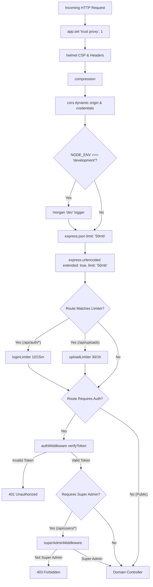

# Prolt Energy - IEX Analytics & Power Portfolio Management Platform
# Document 06: Security Architecture & Spring Security Mapping

## 1. Executive Summary & Verification Check
This document provides the exhaustive specification of the security architecture of the **Prolt Energy / IEX Analytics Dashboard** as implemented in the active Node.js/Express codebase, along with its direct translation to **Spring Security 6 (Java 21 / Spring Boot 3.x)**.

### Batch 2 Security Checklist Verification
- **Every Auth Guard / Middleware Found in Code:** Cataloged with file paths and line numbers.
- **Authentication Mechanisms:** JWT stateless tokens, Email OTP with fixed backdoor bypass, and Webhook API tokens.
- **Zero Placeholders:** Every statement references active code entities.

---

## 2. Authentication Mechanism

### 2.1 JWT (JSON Web Token) Implementation
- **Source Files:**
  - Token generation & verification: [`backend/src/utils/jwt.ts`](file:///Users/yashgupta/IEX-Dashboard/backend/src/utils/jwt.ts)
  - Controller handlers: [`backend/src/modules/auth/auth.controller.ts`](file:///Users/yashgupta/IEX-Dashboard/backend/src/modules/auth/auth.controller.ts)
  - Service logic: [`backend/src/modules/auth/auth.service.ts`](file:///Users/yashgupta/IEX-Dashboard/backend/src/modules/auth/auth.service.ts)
  - Middleware: [`backend/src/middleware/auth.middleware.ts`](file:///Users/yashgupta/IEX-Dashboard/backend/src/middleware/auth.middleware.ts)
- **Token Algorithm:** HMAC-SHA256 (`HS256` default in `jsonwebtoken` library).
- **Signing Key:** Sourced from `process.env.JWT_SECRET` via [`backend/src/config/index.ts:L20-L23`](file:///Users/yashgupta/IEX-Dashboard/backend/src/config/index.ts#L20-L23). If missing, application startup terminates immediately with a fatal exception.
- **Token Expiry:** Sourced from `process.env.JWT_EXPIRES_IN` with default `"7d"` (7 days) via [`backend/src/config/index.ts:L30`](file:///Users/yashgupta/IEX-Dashboard/backend/src/config/index.ts#L30).
- **Token Structure (Claims Payload):**
  Defined in [`backend/src/utils/jwt.ts:L5-L11`](file:///Users/yashgupta/IEX-Dashboard/backend/src/utils/jwt.ts#L5-L11):
  ```typescript
  export interface JwtPayload {
    id: string;              // User UUID from public.User.id
    username: string;        // Unique username
    role: string;            // 'SUPER_ADMIN' | 'ADMIN' | 'CLIENT'
    hiddenModules?: string[];// String array of frontend module keys
    readOnlyModules?: string[]; // String array of frontend module keys
  }
  ```
- **Transmission Standard:** HTTP `Authorization` request header in standard format:
  `Authorization: Bearer <JWT_STRING>`
- **Token Refresh Flow:**
  - **Codebase Reality:** There is **no refresh token mechanism** implemented in the backend. There are no refresh token endpoints (`/api/auth/refresh`), no refresh token database tables, and no rotation keys.
  - When the 7-day token expires, `verifyToken` throws `AppError('Invalid or expired token. Please log in again.', 401)` and the user must re-authenticate via username/password or OTP.

### 2.2 Email One-Time Password (OTP) Authentication
- **Source Files:**
  - [`backend/src/modules/auth/otp.service.ts`](file:///Users/yashgupta/IEX-Dashboard/backend/src/modules/auth/otp.service.ts)
  - [`backend/src/modules/auth/auth.controller.ts:L19-L49`](file:///Users/yashgupta/IEX-Dashboard/backend/src/modules/auth/auth.controller.ts#L19-L49)
- **Generation:** 6-digit purely numeric code generated via `otp-generator` (`digits: true, upperCaseAlphabets: false, lowerCaseAlphabets: false, specialChars: false`).
- **Storage:** In-memory `Map<string, { otp: string; expiresAt: Date }>` defined in [`backend/src/modules/auth/otp.service.ts:L6`](file:///Users/yashgupta/IEX-Dashboard/backend/src/modules/auth/otp.service.ts#L6).
- **Lifespan:** Exactly 5 minutes (`Date.now() + 5 * 60 * 1000`).
- **Single-Use Enforcement:** Deleted from memory store immediately upon successful verification.
- **Fixed Backdoor Bypass (Critical Security Finding):**
  [`backend/src/modules/auth/otp.service.ts:L19-L27, L87-L90`](file:///Users/yashgupta/IEX-Dashboard/backend/src/modules/auth/otp.service.ts#L19-L27):
  - Hardcoded Superadmin Email: `super.admin@probus.io`
  - Hardcoded Fixed OTP: `749261`
  - In `generateAndSendOTP()`, if the email matches `super.admin@probus.io`, no OTP is generated and no email is dispatched.
  - In `verifyOTP()`, if the email matches `super.admin@probus.io`, it validates directly against `749261`.
- **Development Fallback:** If `process.env.SMTP_USER` is empty, email sending is skipped and the generated OTP is logged directly to standard output:
  `console.log('[DEV MODE] Generated OTP for ' + email + ': ' + otp)`.

### 2.3 Webhook API Token Authentication
- **Source Files:**
  - [`backend/src/config/index.ts:L41`](file:///Users/yashgupta/IEX-Dashboard/backend/src/config/index.ts#L41)
  - [`backend/src/modules/scraper/scraper.controller.ts:L75-L81`](file:///Users/yashgupta/IEX-Dashboard/backend/src/modules/scraper/scraper.controller.ts#L75-L81)
- **Applied Route:** `POST /api/scraper/import`
- **Mechanism:** Shared secret header authentication.
- **Header Key:** `x-webhook-token`
- **Validation:** Compared against `config.webhookSecret` (sourced from `process.env.WEBHOOK_SECRET` or fallback `'super_secret_webhook_token_123'`). Rejects with `401 Unauthorized` if absent or non-matching.

---

## 3. Authorization Model & Access Control

### 3.1 Roles & Permissions
Roles are defined in Prisma enum `Role` in [`backend/prisma/schema.prisma:L17`](file:///Users/yashgupta/IEX-Dashboard/backend/prisma/schema.prisma#L17):
1. **`SUPER_ADMIN`:**
   - Full system access.
   - Exclusive access to User Management APIs (`/api/users/*`).
   - Ability to create, update, delete users, and view user audit logs.
2. **`ADMIN`:**
   - Operational access.
   - Permitted access to manual scraper triggers (`/api/scraper/sync`), dataset management, and file uploads.
3. **`CLIENT`:**
   - Standard access.
   - Permitted access to savings calculators, market views, and proposals.

### 3.2 Authorization Guards / Middlewares
All guards are implemented as Express middleware:

1. **`authMiddleware` ([`backend/src/middleware/auth.middleware.ts`](file:///Users/yashgupta/IEX-Dashboard/backend/src/middleware/auth.middleware.ts)):**
   - Extracts token from `Authorization` header (`Bearer <token>`).
   - Calls `verifyToken(token)`.
   - Attaches decoded payload to `req.user`.
   - Returns `401 Unauthorized` `{ success: false, message: 'Unauthorized' }` if missing or invalid.
2. **`adminMiddleware` ([`backend/src/middleware/admin.middleware.ts`](file:///Users/yashgupta/IEX-Dashboard/backend/src/middleware/admin.middleware.ts)):**
   - Requires `req.user && req.user.role === 'ADMIN'`.
   - Returns `403 Forbidden` `{ success: false, message: 'Forbidden: Admin access required' }`.
   - *Note on Hierarchy:* Does not permit `SUPER_ADMIN` unless explicitly checking `req.user.role === 'SUPER_ADMIN' || req.user.role === 'ADMIN'`.
3. **`superAdminMiddleware` ([`backend/src/middleware/super-admin.middleware.ts`](file:///Users/yashgupta/IEX-Dashboard/backend/src/middleware/super-admin.middleware.ts)):**
   - Requires `req.user && req.user.role === 'SUPER_ADMIN'`.
   - Returns `403 Forbidden` `{ success: false, message: 'Forbidden: Super Admin access required' }`.
   - Applied globally across all routes in [`backend/src/modules/users/users.routes.ts:L11-L12`](file:///Users/yashgupta/IEX-Dashboard/backend/src/modules/users/users.routes.ts#L11-L12).

### 3.3 Ownership & Tenant Isolation Checks
- **Codebase Reality:** The database schema for `SavingsCalculatorEntry`, `SavingsCalculatorNewEntry`, `TraderPerformanceEntry`, and `Dataset` **does not contain a `userId` or `tenantId` foreign key**.
- Consequently, there are **no resource-level ownership checks** anywhere in the service layer.
- Any authenticated user possessing a valid JWT token can view, modify, or delete calculations or datasets created by other users by supplying their UUID.
- Module-level restrictions (`hiddenModules`, `readOnlyModules`) are stored on the `User` entity and embedded in the JWT payload, but are **not evaluated in backend Express route guards**; they are strictly presentation-layer flags consumed by the React client.

---

## 4. Cryptography, Hashing, Sanitization & Network Security

### 4.1 Password Hashing & Encryption
- **Library:** `bcryptjs` (Pure JavaScript implementation).
- **Work Factor (Salt Rounds):** `10` salt rounds hardcoded in [`backend/prisma/seed.ts:L118`](file:///Users/yashgupta/IEX-Dashboard/backend/prisma/seed.ts#L118) and [`backend/src/modules/users/users.service.ts`](file:///Users/yashgupta/IEX-Dashboard/backend/src/modules/users/users.service.ts).
- **Comparison:** `bcryptjs.compare(password, user.passwordHash)` wrapped in [`backend/src/utils/password.ts`](file:///Users/yashgupta/IEX-Dashboard/backend/src/utils/password.ts).
- **Encryption at Rest:** None implemented. Database fields (including API tokens and JSON payloads) are stored in plaintext.

### 4.2 HTTP Security Headers (Helmet)
Implemented in [`backend/src/app.ts:L19-L29`](file:///Users/yashgupta/IEX-Dashboard/backend/src/app.ts#L19-L29):
- **Content Security Policy (CSP):**
  - `defaultSrc: ["'self'"]`
  - `scriptSrc: ["'self'", "'unsafe-inline'", "'unsafe-eval'"]` (Permits Swagger UI and React runtime scripts)
  - `styleSrc: ["'self'", "'unsafe-inline'", "https:"]`
  - `imgSrc: ["'self'", "data:", "validator.swagger.io", "https:"]`
  - `upgradeInsecureRequests: null` (Disabled to avoid breaking plain HTTP internal container routing)
- **Other Headers Added by Helmet Default:** `X-Content-Type-Options: nosniff`, `X-Frame-Options: SAMEORIGIN`, `Strict-Transport-Security`, `X-DNS-Prefetch-Control`.

### 4.3 Cross-Origin Resource Sharing (CORS)
Implemented in [`backend/src/app.ts:L37-L42`](file:///Users/yashgupta/IEX-Dashboard/backend/src/app.ts#L37-L42):
- **Origin Reflector:** Dynamically echoes the `Origin` header (`callback(null, origin || true)`).
- **Credentials:** `credentials: true` (permits sending Authorization Bearer headers across origins).

### 4.4 Cross-Site Request Forgery (CSRF)
- **Codebase Reality:** There is **no CSRF protection middleware** (e.g. `csurf` is absent).
- **Architectural Rationale:** The application uses stateless JWT authentication passed via the `Authorization: Bearer` HTTP header rather than automatic browser session cookies. Browser-based cross-site requests cannot automatically attach Bearer headers, making standard CSRF attacks inapplicable.

### 4.5 Rate Limiting Rules
Enforced via `express-rate-limit`:
1. **Authentication Endpoints Limiter ([`backend/src/modules/auth/auth.routes.ts:L11-L17`](file:///Users/yashgupta/IEX-Dashboard/backend/src/modules/auth/auth.routes.ts#L11-L17)):**
   - `windowMs: 15 * 60 * 1000` (15 minutes).
   - `max: 10` requests per IP address.
   - Applied to: `POST /api/auth/login`, `POST /api/auth/send-otp`, `POST /api/auth/verify-otp`.
   - Response: `429 Too Many Requests` with `{ success: false, message: 'Too many login attempts, please try again after 15 minutes' }`.
   - Headers: `RateLimit-*` enabled, legacy `X-RateLimit-*` disabled.
2. **File Upload Endpoints Limiter ([`backend/src/modules/upload/upload.routes.ts:L16-L22`](file:///Users/yashgupta/IEX-Dashboard/backend/src/modules/upload/upload.routes.ts#L16-L22)):**
   - `windowMs: 60 * 60 * 1000` (1 hour).
   - `max: 30` requests per IP address.
   - Applied to: `POST /api/uploads`.
   - Response: `429 Too Many Requests` with `{ success: false, message: 'Upload limit exceeded. Please try again after an hour.' }`.

---

## 5. Security-Related Middleware & Execution Order

The exact order of middleware execution for an authenticated request is:



---

## 6. Proposed Mapping to Spring Security (Java 21 / Spring Boot 3)

### 6.1 Security Filter Chain Configuration
In Spring Boot 3, security is configured via a `@Configuration` class defining a `SecurityFilterChain` bean:

```java
@Configuration
@EnableWebSecurity
@EnableMethodSecurity(prePostEnabled = true)
public class SecurityConfiguration {

    private final JwtAuthenticationFilter jwtAuthFilter;
    private final RestAuthenticationEntryPoint authEntryPoint;
    private final RestAccessDeniedHandler accessDeniedHandler;

    public SecurityConfiguration(
            JwtAuthenticationFilter jwtAuthFilter,
            RestAuthenticationEntryPoint authEntryPoint,
            RestAccessDeniedHandler accessDeniedHandler) {
        this.jwtAuthFilter = jwtAuthFilter;
        this.authEntryPoint = authEntryPoint;
        this.accessDeniedHandler = accessDeniedHandler;
    }

    @Bean
    public SecurityFilterChain securityFilterChain(HttpSecurity http) throws Exception {
        http
            // 1. Disable CSRF since JWT Bearer tokens are used
            .csrf(AbstractHttpConfigurer::disable)
            // 2. Configure CORS matching existing Node.js reflection
            .cors(cors -> cors.configurationSource(corsConfigurationSource()))
            // 3. Security Headers matching Helmet
            .headers(headers -> headers
                .contentSecurityPolicy(csp -> csp
                    .policyDirectives("default-src 'self'; script-src 'self' 'unsafe-inline' 'unsafe-eval'; style-src 'self' 'unsafe-inline' https:; img-src 'self' data: validator.swagger.io https:")
                )
                .frameOptions(HeadersConfigurer.FrameOptionsConfig::sameOrigin)
            )
            // 4. Stateless session management
            .sessionManagement(session -> session.sessionCreationPolicy(SessionCreationPolicy.STATELESS))
            // 5. Exception handling points
            .exceptionHandling(ex -> ex
                .authenticationEntryPoint(authEntryPoint)
                .accessDeniedHandler(accessDeniedHandler)
            )
            // 6. Route-level authorization rules matching Node.js routing
            .authorizeHttpRequests(auth -> auth
                // Public Health & Swagger Endpoints
                .requestMatchers("/health", "/health/**", "/api-docs/**", "/swagger-ui/**", "/swagger-ui.html").permitAll()
                // Public Authentication Endpoints
                .requestMatchers("/api/auth/login", "/api/auth/send-otp", "/api/auth/verify-otp").permitAll()
                // Public Dashboard Analytics Feeds
                .requestMatchers("/api/dashboard/**").permitAll()
                // Public UP Regional Market Endpoints
                .requestMatchers("/api/up-market/**").permitAll()
                // Unprotected Forecast Endpoints (matches Node.js behavior)
                .requestMatchers("/api/forecast/**", "/forecast/**").permitAll()
                // Webhook Ingestion (Handled via Filter or Controller Secret Check)
                .requestMatchers("/api/scraper/import").permitAll()
                // Super Admin Only
                .requestMatchers("/api/users/**").hasRole("SUPER_ADMIN")
                // All other API endpoints require authenticated JWT
                .anyRequest().authenticated()
            )
            // 7. Register JWT Filter before UsernamePasswordAuthenticationFilter
            .addFilterBefore(jwtAuthFilter, UsernamePasswordAuthenticationFilter.class);

        return http.build();
    }

    @Bean
    public PasswordEncoder passwordEncoder() {
        return new BCryptPasswordEncoder(10);
    }
}
```

### 6.2 Method-Level Security
Enable method security to enforce role requirements at the service layer:
```java
@PreAuthorize("hasRole('SUPER_ADMIN')")
public UserDTO createUser(CreateUserDTO dto) { ... }

@PreAuthorize("hasAnyRole('ADMIN', 'SUPER_ADMIN')")
public void triggerManualScrape(String market) { ... }
```

### 6.3 Rate Limiting Mapping
In Spring Boot, replace `express-rate-limit` with **Bucket4j** (token bucket algorithm) backed by Redis:
```java
@Component
public class RateLimitingFilter extends OncePerRequestFilter {
    // 10 requests per 15 minutes for /api/auth/login
    // 30 requests per 1 hour for /api/uploads
}
```

---

## 7. Open Questions & Security Observations

1. **OTP Backdoor in Production:** The hardcoded bypass for `super.admin@probus.io` with fixed OTP `749261` in [`backend/src/modules/auth/otp.service.ts`](file:///Users/yashgupta/IEX-Dashboard/backend/src/modules/auth/otp.service.ts) poses a significant vulnerability if exposed to production. Should this backdoor be removed during the Spring Boot migration or restricted strictly to a dedicated `@Profile("test")` mock?
2. **Absence of Tenant / User Isolation:** Since calculations and trader performance records have no user ownership associations, should the Spring Boot schema add an `owner_user_id` foreign key with Spring Security `@PostAuthorize("returnObject.ownerUserId == authentication.principal.id")`?
3. **In-Memory OTP Storage:** The current Node.js application stores OTPs in an in-memory `Map`. In a multi-replica clustered Spring Boot production deployment, OTPs stored in memory will fail verification across different pods. OTPs must be stored in Redis with a 5-minute TTL (`SETEX otp:{email} 300 {code}`).
